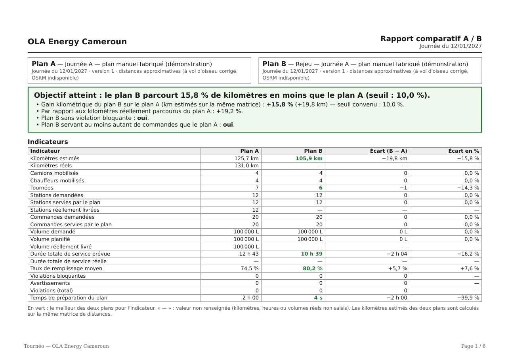

# Démonstrations de Tournéo — pas-à-pas, critères d'acceptation, limites connues

Ce document sert à **dérouler les démos de chaque jalon** (spec §12) sur des données réalistes, par les
mêmes portes qu'un utilisateur : l'API et les fichiers d'import. Il tient aussi l'**état des sept critères
d'acceptation** (spec §13) et la liste des **défauts d'intégration** que les scénarios de bout en bout ont
fait apparaître.

Tout ce qui suit a été exécuté tel quel le 21/11/2026 sur un poste de développement (PostgreSQL + PostGIS,
Redis, API et worker Celery en local, **sans OSRM** : distances à vol d'oiseau corrigées, plans marqués
« approximatifs »). Ce qui n'a pas pu être vérifié est signalé comme tel.

## Sommaire

1. [Ce qui est livré](#1-ce-qui-est-livré)
2. [Préparation](#2-préparation)
3. [Démos par jalon](#3-démos-par-jalon)
4. [Critères d'acceptation](#4-critères-dacceptation-spec-13)
5. [Défauts d'intégration trouvés](#5-défauts-dintégration-trouvés)
6. [Limites connues](#6-limites-connues)

---

## 1. Ce qui est livré

| Élément | Où | Rôle |
|---|---|---|
| Jeux importables | `data/fixtures/<jeu>/import/` | `depots.xlsx`, `stations.xlsx`, `trucks.xlsx`, `drivers.xlsx`, `orders.xlsx` au format exact des modèles ; `depot_stocks.json` ; `compute.json` (paramètres de calcul du jeu, affectations du jour) |
| Journée A fabriquée | `data/fixtures/demo_douala/import/reference_day.xlsx` | Plan manuel plausible et médiocre, au format `reference_day.xlsx` |
| `scripts/demo/export_fixture.py` | | `problem.json` → fichiers importables (reproductibles à l'octet près) |
| `scripts/demo/make_reference_day.py` | | Fabrique la journée A (heuristique du « dispatcher pressé ») |
| `scripts/demo/load_demo.py` | | Charge un jeu **par l'API seule** ; options `--compute`, `--ab`, `--day` |
| `scripts/demo/run_day.py` | | Déroule une journée par l'API : correction, publication, chargement, livraisons |
| Tests de bout en bout | `backend/tests/e2e/` | Scénario d'une journée, preuve A/B, passage à l'échelle, critères d'acceptation, défauts en `xfail` |
| Captures du rapport A/B | `docs/demo/` | Contrôle visuel du PDF produit |

Les trois jeux (`problem.json`, lot L2, non modifiés) :

| Jeu | Contenu | Attendu |
|---|---|---|
| `demo_douala` | 1 dépôt, 12 stations, 4 camions, 5 chauffeurs, 20 commandes (2 urgentes, 1 fenêtre 10:00–11:00, 1 station réservée aux petits camions) | tout servi, 0 violation |
| `demo_shortage` | `demo_douala` avec 30 000 L de gasoil pour 43 000 L demandés | 2 commandes non servies `depot_stock` |
| `demo_scale` | 2 dépôts, 69 stations (voir défaut D1), 25 camions, 28 chauffeurs, 120 commandes | calcul < 60 s, 0 violation bloquante |

Régénérer les fichiers après une modification des jeux ou des modèles d'import :

```bash
cd backend && uv run python ../scripts/demo/export_fixture.py --all
```

```bash
cd backend && uv run python ../scripts/demo/make_reference_day.py
```

Un test (`tests/e2e/test_jeux_importables.py`) échoue si les fichiers versionnés ne sont plus à jour.

---

## 2. Préparation

### 2.1 En développement (sans Docker) — vérifié

Trois terminaux.

```bash
./scripts/dev_setup.sh
```

```bash
cd backend && uv run uvicorn app.main:app_instance --port 8000
```

```bash
cd backend && uv run celery -A app.worker.celery_app worker -l info -c 2
```

`dev_setup.sh` installe PostgreSQL + PostGIS et Redis, crée les bases, applique les migrations et insère
les paramètres, les trois produits et le compte administrateur. Le worker Celery exécute les calculs
(`POST /plans/compute`, recalcul, rejeu). Contrôle :

```bash
curl -s http://localhost:8000/api/v1/health
```

Réponse attendue : `{"status":"ok","checks":{"database":"ok","redis":"ok"}}`.
Documentation interactive de l'API : <http://localhost:8000/api/v1/docs>.

### 2.2 Avec `docker compose up` — non vérifié ici

Pas de démon Docker dans l'environnement de développement cloud : cette variante **n'a pas été exécutée**.
Installation et premier démarrage : [`EXPLOITATION.md`](EXPLOITATION.md) §2 à §4. L'image de l'API contient
`backend/app` et `data/` mais pas `scripts/` ; deux façons de lancer les scripts de démonstration :

- depuis un poste qui a le dépôt et `uv`, en visant l'API publiée :

  ```bash
  cd backend && uv run python ../scripts/demo/load_demo.py demo_douala --base-url https://tourneo.exemple.cm --admin-email "$TOURNEO_ADMIN_EMAIL" --admin-password "$TOURNEO_ADMIN_PASSWORD"
  ```

- ou dans un conteneur de l'image, en montant le dossier des scripts (à valider au premier essai) :

  ```bash
  docker compose run --rm -v "$PWD/scripts:/srv/tourneo/scripts:ro" api python /srv/tourneo/scripts/demo/load_demo.py demo_douala --base-url http://api:8000
  ```

### 2.3 Comptes

| Compte | Mot de passe | Rôle | Créé par |
|---|---|---|---|
| `admin@honowa.tech` | `admin-dev-only` (développement ; en production : `TOURNEO_ADMIN_EMAIL` / `TOURNEO_ADMIN_PASSWORD`) | `admin` | `python -m app.cli seed` |
| `dispatcher@demo.tourneo.cm` | `demo-tourneo-2027` | `dispatcher` | `load_demo.py` |
| `supply@demo.tourneo.cm` | `demo-tourneo-2027` | `supply` | `load_demo.py` |
| `fleet@demo.tourneo.cm` | `demo-tourneo-2027` | `fleet` | `load_demo.py` |
| `manager@demo.tourneo.cm` | `demo-tourneo-2027` | `manager` | `load_demo.py` |

Les comptes de démonstration sont créés par l'administrateur **par l'API** (`POST /users`) au premier
chargement. Ils ne conviennent pas à la production : les désactiver après la démo.

La connexion est limitée à 10 tentatives par minute et par adresse : enchaîner plusieurs chargements en
moins d'une minute fait attendre le chargeur (message « trop de connexions récentes »), sans échec.

---

## 3. Démos par jalon

Toutes les commandes se lancent depuis `backend/`. Le jour des jeux est le **mardi 12/01/2027** ;
`--day AAAA-MM-JJ` rejoue commandes et stocks à une autre date.

### J1 — Connexion, import des fichiers modèles, stations et dépôts sur la carte

```bash
uv run python ../scripts/demo/load_demo.py demo_douala
```

Ce qu'on doit voir :

```
→ Connexion (admin@honowa.tech) et comptes de démonstration
→ Import depots.xlsx : 1 créé(s), 0 mis à jour, 0 inchangé(s), 0 avertissement(s)
→ Import stations.xlsx : 12 créé(s), 0 mis à jour, 0 inchangé(s), 0 avertissement(s)
→ Import trucks.xlsx : 4 créé(s), 0 mis à jour, 0 inchangé(s), 2 avertissement(s)
→ Import drivers.xlsx : 5 créé(s), 0 mis à jour, 0 inchangé(s), 0 avertissement(s)
→ Import orders.xlsx : 20 créé(s), 0 mis à jour, 0 inchangé(s), 0 avertissement(s)
→ Stocks dépôt du 12/01/2027 : 3 couple(s) (dépôt, produit) saisis
→ Commandes du jour : 20 confirmée(s) à l'instant (0 avertissement(s)) ; 20 au total {'confirmed': 20}
```

- Chaque import passe par **prévisualiser** (`POST /imports/{kind}/preview`) puis **appliquer**
  (`POST /imports/{batch_id}/apply`). Les 2 avertissements des camions annoncent la création automatique
  des transporteurs « OLA Flotte » et « Sotracam ».
- Les référentiels sont importés par l'administrateur, les commandes par le dispatcher, les stocks saisis
  par le compte Supply (visible dans l'historique : `GET /availability/depot-stocks/history?day=2027-01-12`).
- **Relancer la même commande** : tout est « inchangé », aucune commande n'est reconfirmée, aucun stock
  n'est ressaisi. C'est la démonstration du « sans écraser silencieusement » de F1.6.
- Stations et dépôts « sur la carte » : `GET /stations` et `GET /depots` renvoient `lat` / `lon` pour les
  12 stations et le dépôt ; à l'écran, **Référentiels → Stations** (socle de l'interface, lot L9).
- Pour montrer le rapport d'erreurs ligne par ligne : modifier une cellule d'un fichier (par exemple un
  gabarit « énorme » dans `stations.xlsx`) et le prévisualiser depuis l'écran Référentiels ou
  `/api/v1/docs` — le lot est `rejected` et rien n'est écrit.

### J2 — `POST /plans/compute` sur `demo_douala` → plan sans violation

```bash
uv run python ../scripts/demo/load_demo.py demo_douala --compute
```

Ce qu'on doit voir, après la progression du calcul (4 s environ) :

```
plan … : 6 tournée(s), 4 camion(s), 105.9 km, 20 commande(s) servie(s), 0 non servie(s),
0 violation(s) bloquante(s), 0 avertissement(s) — distances approximatives (OSRM indisponible)
```

- Le chargeur appelle `POST /plans/compute {day, params: {"solver_time_limit_s": 6}}` (202 + `task_id`),
  suit `GET /tasks/{task_id}` puis lit `GET /plans/{id}`.
- Avec OSRM (docker compose), les kilomètres changent et la mention « approximatives » disparaît.
- Variante pénurie : `uv run python ../scripts/demo/load_demo.py demo_shortage --compute` sur une base
  vide → 18 commandes servies, **2 non servies** (`depot_stock`, gasoil), 0 violation bloquante.

### J3 — Le dispatcher corrige un plan et publie

```bash
uv run python ../scripts/demo/run_day.py demo_douala --until publish --pdf-dir /tmp/tourneo-pdf
```

Le script joue le dispatcher, par l'API (les écrans de la vague 2 feront la même chose à la souris) :

1. reprend le brouillon calculé (ou le calcule) et affiche ses tournées ;
2. **déplace un arrêt** d'une tournée à une autre (`POST /plans/{id}/trips/{trip}/move-stop`). Le serveur
   recontrôle aussitôt : un essai qui crée une violation bloquante (RM-05 compartiments, RM-09 gabarit…)
   est affiché puis annulé, le premier essai sans violation est gardé ;
3. **verrouille** la tournée modifiée (`…/lock`) et lance **« recalculer en conservant »**
   (`POST /plans/{id}/recompute`) : la tournée 🔒 ressort inchangée, les autres sont réoptimisées ;
4. **publie** (`POST /plans/{id}/publish`) : les 20 commandes passent `planned` ; les **feuilles de route**
   sont enregistrées dans `/tmp/tourneo-pdf/feuilles_de_route.pdf`.

Ce qu'on doit voir à la fin :

```
   essai : DLA12 → tournée 5 : violation bloquante RM-09 — annulé
→ Arrêt DLA09 déplacé de la tournée 6 vers la tournée 5 (1 essai(s) refusé(s) par les règles auparavant)
→ Tournée modifiée verrouillée ; recalcul en conservant les tournées verrouillées
   tournée 5 — LT-402-AB (Alain Nkoulou), départ 12:11, 22.0 km 🔒 : DLA09 → DLA06 → DLA04
   6 tournée(s), 115.2 km, 0 non servie(s), 0 violation(s) bloquante(s), 0 avertissement(s)
→ Plan publié (version 1) : 20 commande(s) « planned »
```

Le premier essai (DLA12, station réservée aux petits camions, vers un camion moyen) est refusé par RM-09 :
c'est le recontrôle immédiat de F5.2. La correction manuelle coûte ici 9,3 km (115,2 km contre 105,9 km) :
le plan affiche le prix d'un choix du dispatcher. L'arrêt déplacé et les kilomètres peuvent différer d'une
machine à l'autre. L'historique « qui a changé quoi, quand » se lit par `GET /plans/{id}/versions`.
Une violation bloquante **empêche la publication** (409 avec `rule_code`) : c'est vérifié par le test
`test_journee_complete…` (station DLA12, réservée aux petits camions, posée sur un camion moyen → RM-09).

### J4 — Scénario complet d'une journée, de la commande à la livraison

Sur une base où le plan n'est pas encore publié :

```bash
uv run python ../scripts/demo/run_day.py demo_douala --pdf-dir /tmp/tourneo-pdf
```

Après les étapes de J3, le script joue l'agent Fleet, tournée par tournée :

- `PUT /trips/{id}/status` → `at_depot` ; `POST /trips/{id}/loading` (volumes observés, température, bon
  de chargement) ; fiche de chargement PDF ; `loaded` ; `in_progress` ;
- `PUT /stops/{id}/delivery` pour chaque arrêt ; le dernier arrêt de la dernière tournée est **sauté**
  (station fermée) ; `completed` avec heure de retour et kilomètres réels.

Ce qu'on doit voir :

```
→ Tournée 1 (CE-404-AD) chargée à 27 °C : 11 000 L observés, 10 863 L à 15 °C (écart -1.25 %)
→ Tournée 2 (LT-402-AB) chargée à 36 °C : 20 000 L observés, 19 570 L à 15 °C (écart -2.15 %) ⚠ Écart entre
  volume chargé à 15 °C et volume planifié au-delà de la tolérance (2 %) — compartiment 1 : −172,87 L (−2,52 %) …
   arrêt DLA08 sauté (station fermée) : commandes à replanifier

Tableau de bord du 2027-01-12 :
  tournées : {"planned": 0, "at_depot": 0, "loaded": 0, "in_progress": 0, "completed": 6}
  arrêts : 11 livré(s), 1 sauté(s), 0 en attente
  volumes : 90 000 L livrés sur 100 000 L planifiés
  retards : 6 tournée(s), au plus 25 min
  alertes : 1 (dont 0 bloquante(s))
  commandes : {'delivered': 18, 'confirmed': 2}
```

- La conversion à 15 °C suit RM-12 : 11 000 L de super et de gasoil à 27 °C → 10 863 L. À 36 °C, le super
  dépasse la tolérance de 2 % : avertissement RM-13 sur la tournée, sur la fiche et au tableau de bord.
- Les commandes de l'arrêt sauté reviennent à `confirmed` (à replanifier) — mais voir les défauts D4 et D5 :
  leur replanification ne fonctionne pas encore.
- Journal d'audit : `GET /audit?table=trips&row_id=<id>` (rôle `manager` ou `admin`) montre la suite
  `at_depot → loaded → in_progress → completed` avec l'auteur de chaque écriture.
- Les **événements** (panne de camion, chauffeur indisponible, pénurie — F6) appartiennent au lot L10, en
  cours : ils ne font pas encore partie de cette démo.

Le même scénario, avec toutes ses vérifications (statuts des commandes, tournées et arrêts à chaque étape) :

```bash
uv run pytest tests/e2e/test_journee_complete.py
```

### J5 — Journée de référence, rejeu, rapport A/B

La journée A réelle d'OLA n'est pas encore fournie. La démo utilise une **journée A fabriquée** :
`reference_day.xlsx`, produite par `make_reference_day.py` à partir des 20 commandes de `demo_douala`
(stations prises dans l'ordre de leur code, camions dans l'ordre des immatriculations, premier qui rentre ;
plan réalisable, sans optimisation).

```bash
uv run python ../scripts/demo/load_demo.py demo_douala --ab --pdf /tmp/tourneo-pdf/comparaison_AB.pdf
```

Le chargeur importe la journée (`POST /reference-days/import` → plan `manual_reference`), la fait rejouer
par le moteur (`POST /plans/{id}/replay` → plan `replay`), lit `GET /comparison` et enregistre
`GET /comparison.pdf`. Ce qu'on doit voir :

```
Comparaison A / B (journée manuelle fabriquée → rejeu du moteur)
  A (manuel)  : 125.7 km, 4 camion(s), 7 tournée(s), 20/20 commande(s), 0 violation(s) bloquante(s)
  B (calculé) : 105.9 km, 4 camion(s), 6 tournée(s), 20/20 commande(s), 0 violation(s) bloquante(s)
  gain kilométrique : 19.8 km (15.8 %) pour un seuil de 10 %
  verdict : Objectif atteint : le plan B parcourt 15,8 % de kilomètres en moins que le plan A (seuil : 10,0 %).
```

Le rapport PDF (6 pages : synthèse et verdict, cartes côte à côte, annexes par tournée) a été contrôlé
visuellement ; captures :

- synthèse : [`demo/comparaison_AB_demo_douala-1.png`](demo/comparaison_AB_demo_douala-1.png)
- cartes : [`demo/comparaison_AB_demo_douala-2.png`](demo/comparaison_AB_demo_douala-2.png)
- annexe : [`demo/comparaison_AB_demo_douala-3.png`](demo/comparaison_AB_demo_douala-3.png)



| Indicateur | A — manuel fabriqué | B — rejeu du moteur | Écart |
|---|---|---|---|
| Kilomètres estimés (même matrice) | 125,7 km | 105,9 km | −19,8 km (−15,8 %) |
| Kilomètres « réels » de A (fabriqués : estimés + 5 %) | 131,0 km | — | gain de B : 19,2 % |
| Camions mobilisés | 4 | 4 | 0 |
| Tournées | 7 | 6 | −1 |
| Commandes servies / demandées | 20 / 20 | 20 / 20 | 0 |
| Durée totale de service | 12 h 43 | 10 h 39 | −2 h 04 |
| Taux de remplissage moyen | 74,5 % | 80,2 % | +5,7 points |
| Violations bloquantes | 0 | 0 | 0 |
| Temps de préparation | 2 h 00 (déclaré) | 4 s | |

**Ce résultat prouve la chaîne, pas le gain chez OLA** : la journée A est fabriquée par une heuristique
naïve ; le gain réel se mesurera sur la journée fournie par OLA (question Q6).

La journée de référence et les commandes du jour cohabitent sans se mélanger (l'import crée ses propres
commandes, jamais `confirmed`) : `--ab` peut suivre les démos J2 à J4 sur la même base.

### Recette sur `demo_scale` (J5)

```bash
uv run python ../scripts/demo/load_demo.py demo_scale --compute
```

ou, avec les temps détaillés :

```bash
uv run pytest tests/e2e/test_echelle.py -m slow -s
```

Temps mesurés (import par les fichiers puis calcul par le service réel, sans OSRM) :

| Étape | Temps |
|---|---|
| Import `depots.xlsx` (2 dépôts) | 0,09 s |
| Import `stations.xlsx` (69 stations, 157 cuves) | 0,21 s |
| Import `trucks.xlsx` (25 camions, 123 compartiments) | 0,16 s |
| Import `drivers.xlsx` (28 chauffeurs) | 0,11 s |
| Import `orders.xlsx` (120 commandes) | 0,14 s |
| Confirmation en masse des 120 commandes | 0,83 s |
| **Chargement complet** (connexions, comptes, imports, stocks, confirmation) | **2,98 s** |
| Construction du problème (lecture de la base) | 0,05 s |
| Matrice de distances (repli haversine) | 0,20 s |
| Calcul des tournées (moteur OR-Tools, limite 30 s) | 22,84 s |
| Enregistrement du plan | 0,14 s |
| **Calcul complet** (`run_compute`) | **23,23 s** (seuil : 60 s) |
| Lecture du plan complet (`GET /plans/{id}`) | 0,07 s |

Résultat : 32 tournées, 23 camions sur 25, 3 753,8 km, **120 commandes servies sur 120, 0 violation
bloquante, 0 avertissement**, les deux dépôts utilisés. Chaque import comprend prévisualisation et
application.

---

## 4. Critères d'acceptation (spec §13)

Tests : `backend/tests/e2e/test_acceptance.py` (un test par critère vérifiable automatiquement).

| # | Critère | État au 21/11/2026 | Preuve |
|---|---|---|---|
| 1 | Rejeu de la journée A sans violation bloquante, au moins autant de commandes servies | **Vérifié sur la journée fabriquée** (0 violation bloquante, 20/20 comme le manuel). À refaire sur la journée réelle d'OLA. | `test_critere_1_…`, `tests/e2e/test_preuve_ab.py` |
| 2 | Kilométrage calculé inférieur d'au moins `ab_success_threshold_pct` (10 %) | **Vérifié sur la journée fabriquée** : 105,9 km contre 125,7 km, gain 15,8 %. Le verdict suit bien le paramètre. À refaire sur la journée réelle. | `test_critere_2_…` |
| 3 | Calcul < 60 s sur `demo_scale` et sur les données réelles | **Vérifié sur `demo_scale`** par l'API : 23,2 s tout compris, sans OSRM. À mesurer avec OSRM (matrice, cache froid) et sur les données d'OLA. | `test_critere_3_…` (`-m slow`), `tests/e2e/test_echelle.py` |
| 4 | Un dispatcher formé une heure réalise seul import, calcul, déplacement d'un arrêt, publication, panne | **Non vérifiable ici.** Dépend des écrans (lots L11 à L13, vague 2) et du traitement de la panne (L10). La séquence est faisable par l'API de bout en bout, sauf la panne. À vérifier chez OLA. | — |
| 5 | RM-01 à RM-20 ont un test automatisé qui passe ; couverture de `planning` ≥ 80 % | **Partiel.** 19 règles sur 20 ont un test `test_RM_xx…` ; il manque **RM-19** (panne : lot L10 non livré). Couverture de `app/planning` : **94 %** (3 374 instructions, `uv run pytest --cov=app/planning`, suite complète). | `test_critere_5_…` (RM-19 en `xfail`) |
| 6 | Redémarrage sans perte (`docker compose down && up`), sauvegarde restaurable en moins de 30 min | **Non vérifiable ici** (pas de démon Docker). Procédure écrite : [`EXPLOITATION.md`](EXPLOITATION.md) §8 et §9 ; à chronométrer sur un VPS vierge. | — |
| 7 | Aucun fichier Excel lu ailleurs que dans `imports/` | **Vérifié** dans `backend/app` (contrôle du lot L3) et dans `scripts/` (les scripts de démonstration écrivent des classeurs, ne lisent que du JSON). | `test_critere_7_…` |

Quand le lot L10 livrera son `test_RM_19_…`, le test `test_critere_5_…[RM-19]` passera : `xfail(strict)`
le signalera, et il suffira de vider le dictionnaire `MISSING` de `test_acceptance.py`.

---

## 5. Défauts d'intégration trouvés

Chacun est figé par un test `xfail(strict=True)` de `backend/tests/e2e/test_defauts_integration.py` : le
test décrit le comportement attendu, échoue aujourd'hui, et signalera la correction. Aucun module d'un
autre lot n'a été modifié.

### D1 — `demo_scale` : deux stations portent le même identifiant (lot L2) — *données*

- **Où** : `scripts/gen_fixtures.py::build_demo_scale`, `code = f"{city[:3].upper()…}{k:02d}"`.
- **Entrée** : les villes « Mbanga » et « Mbalmayo » donnent toutes deux `MBA01`.
- **Attendu** : 70 stations distinctes (spec §7.5).
- **Constaté** : `data/fixtures/demo_scale/problem.json` contient deux stations d'identifiant et de code
  `MBA01` (« OLA Mbanga 1 » et « OLA Mbalmayo 1 ») : 69 stations distinctes. `problem.station("MBA01")`
  renvoie la première : les deux commandes passées sur `MBA01` (CMD039, CMD106) sont livrées à Mbanga, quelle
  que soit la station que le générateur visait, et Mbalmayo 1 n'est jamais desservie. L'import refuse le
  doublon (« Doublon : le produit SUPER figure déjà… »), comme il se doit.
- **Contournement dans L15** : l'export écarte la seconde station et l'annonce.
- **Piste** : préfixe de code sur 4 lettres ou suffixe en cas de collision ; test d'unicité des identifiants.
- **Test** : `test_defaut_demo_scale_a_70_stations_distinctes`.

### D2 — Une nouvelle version d'un plan publié perd les chargements enregistrés (L5 × L6) — *bloquant pour J4*

- **Où** : `app/planning/versions.py::copy_plan` (appelé par `create_version`).
- **Entrée** : plan publié ; Fleet enregistre le chargement de la tournée 1 (`loaded`) ; le dispatcher
  modifie une **autre** tournée (inversion de deux arrêts) → version 2, qu'il publie.
- **Attendu** : dans la version en vigueur, la tournée 1 garde son chargement.
- **Constaté** : la tournée copiée a un nouvel identifiant et le statut `loaded`, mais `loadings` reste
  rattaché à l'ancienne tournée : `GET /trips/{id}/loading` → 404 `loading_not_found`,
  `GET /trips/{id}/loading-sheet.pdf` → 409 `loading_missing`, `loading_recorded: false` dans
  `GET /loadings`. La fiche de chargement n'est plus accessible et l'avertissement RM-13 disparaît.
- **Piste** : recopier `loadings` / `loading_lines` dans `copy_plan` (et la violation RM-13), ou conserver
  l'identifiant des tournées non modifiées d'une version à l'autre.
- **Test** : `test_defaut_nouvelle_version_d_un_plan_publie_conserve_le_chargement_enregistre`.

### D3 — La publication d'une version écrase l'avancement saisi entre-temps (L5 × L6) — *bloquant pour J4*

- **Où** : `app/planning/versions.py::create_version` / `app/planning/service.py::publish_plan`.
- **Entrée** : plan publié, tournée 1 `loaded` ; le dispatcher ouvre une version 2 (brouillon) ; pendant
  ce temps Fleet passe la tournée 1 à `in_progress` sur la version 1, toujours en vigueur ; le dispatcher
  publie la version 2.
- **Attendu** : la tournée 1 est `in_progress` dans la version en vigueur.
- **Constaté** : elle revient à `loaded` (état au moment de la copie) ; l'heure de départ réelle et toute
  livraison saisie entre-temps sont perdues (elles restent sur la version archivée).
- **Piste** : à la publication, resynchroniser l'état d'exécution depuis la version précédente ; ou refuser
  les écritures Fleet tant qu'un brouillon existe ; ou séparer l'exécution (statuts, heures réelles,
  chargements) du plan versionné.
- **Test** : `test_defaut_la_publication_d_une_version_ne_perd_pas_l_avancement_saisi_entre_temps`.

### D4 — Une commande libérée par un arrêt sauté ne peut pas être replanifiée (L5 × L6)

- **Où** : `app/planning/mapping.py::planned_elsewhere` (utilisé par `service._remainders`).
- **Entrée** : plan publié ; un arrêt est sauté (`PUT /stops/{id}/delivery {skip_reason}`) : ses commandes
  reviennent à `confirmed`. Le dispatcher relance `POST /plans/compute` pour le jour.
- **Attendu** : un plan qui sert ces commandes.
- **Constaté** : la route répond 202 (il y a des commandes `confirmed`), puis la tâche échoue :
  « Aucune commande confirmée à planifier pour le 12/01/2027 ». `planned_elsewhere` additionne les
  `stop_deliveries.planned_l` des plans publiés sans écarter les arrêts `skipped` : le reliquat vaut 0.
- **Piste** : ignorer les arrêts `skipped` (et les livraisons à volume réel nul) dans `planned_elsewhere`.
- **Test** : `test_defaut_commande_d_un_arret_saute_replanifiable_par_un_nouveau_calcul`.

### D5 — « Recalculer en conservant » fait disparaître les commandes d'un arrêt sauté (L5 × L6)

- **Où** : `app/planning/service.py::run_recompute` puis `_sync_order_statuses`.
- **Entrée** : même situation que D4, mais le dispatcher lance `POST /plans/{id}/recompute` sur le plan
  publié, puis publie la nouvelle version.
- **Attendu** : chaque commande de l'arrêt sauté est reprise par un arrêt à venir, ou listée non servie
  avec sa raison (F4.4).
- **Constaté** : la tournée terminée est figée avec son arrêt `skipped`, dont les livraisons comptent
  comme servies : 0 non servie, aucun nouvel arrêt. À la publication, les commandes repassent `planned`
  alors que plus rien ne les livre : **elles sortent silencieusement du radar** (ni à replanifier, ni
  non servies).
- **Piste** : dans `run_recompute`, ne pas compter comme servies les livraisons d'arrêts `skipped` des
  tournées figées ; même correction que D4 pour `_sync_order_statuses`.
- **Test** : `test_defaut_recalcul_du_plan_publie_ne_perd_pas_les_commandes_d_un_arret_saute`.

### D6 — RM-08 : le stock dépôt n'est pas décompté entre les plans publiés du même jour (L5 × L1)

- **Où** : `app/planning/mapping.py::assemble_problem` (stock transmis au moteur et aux règles).
- **Entrée** : `demo_shortage` (30 000 L de gasoil, 43 000 L demandés). Premier calcul : 30 000 L planifiés,
  2 commandes non servies `depot_stock` ; publication. Les 2 commandes restent `confirmed` ; second calcul.
- **Attendu** : RM-08 porte sur « le volume **total** planifié d'un produit au départ d'un dépôt pour J » :
  les 2 commandes restent non servies (ou violation RM-08 bloquante).
- **Constaté** : le second plan sert les 13 000 L de gasoil manquants, sans violation : 43 000 L planifiés
  pour 30 000 L en stock. Chaque plan est contrôlé contre le stock entier.
- **Piste** : retirer du stock transmis les volumes des autres plans publiés du jour (comme le reliquat de
  RM-16), en ignorant la lignée du plan en cours de modification.
- **Test** : `test_defaut_rm_08_stock_depot_cumule_entre_les_plans_publies_du_jour`.

### D7 — Motif d'indisponibilité d'un chauffeur avec une valeur technique en anglais (socle) — *mineur*

- **Où** : `app/planning/violations/eligibility.py::driver_unavailable_reason`.
- **Entrée** : chauffeur de statut `leave` (`demo_scale`), `GET /availability/drivers?day=…`.
- **Attendu** : « Chauffeur indisponible (statut : congé). » — messages d'interface en français.
- **Constaté** : « Chauffeur indisponible (statut : leave). »
- **Piste** : table de libellés, comme `_TRUCK_STATUS_FR` pour les camions dans le même fichier.
- **Test** : `test_defaut_motif_d_indisponibilite_du_chauffeur_en_francais`.

### Constats sans test

- `scripts/dev_setup.sh` démarre `redis-server --daemonize yes` depuis la racine du dépôt : Redis y écrit
  son fichier `dump.rdb`, qui n'est pas ignoré par git (risque de le commiter). Piste : `--dir /tmp` ou une
  ligne dans `.gitignore`.
- Deux sessions `pytest` lancées en même temps se marchent dessus (la base `tourneo_test` est recréée au
  début de chaque session) : une seule suite à la fois.
- `demo_scale` contient trois chauffeurs nommés « Fabrice Manga ». Sans conséquence pour les imports (clé :
  numéro de permis), mais une journée de référence qui désignerait ces chauffeurs par leur nom serait
  refusée (homonymes, question L7-16).

---

## 6. Limites connues

- **Pas d'OSRM** dans cet environnement : toutes les distances sont à vol d'oiseau × 1,3, tous les plans
  sont « approximatifs ». Les kilomètres et le gain A/B changeront avec OSRM ; le temps de calcul de la
  matrice aussi (critère 3).
- **Pas de Docker** : `docker compose up`, le redémarrage sans perte et la restauration (critère 6) ne sont
  pas vérifiés ; la tâche Celery réelle l'a été en local (API + worker + Redis), pas dans les tests
  automatisés, qui exécutent `service.run_compute` avec la session du test.
- **Journée A fabriquée** : heuristique naïve sur `demo_douala`. Les critères 1 et 2 restent à prouver sur
  la journée réelle d'OLA.
- **Événements** (panne, chauffeur indisponible, pénurie en cours de journée) : lot L10, non livré ; ni
  démo ni test de RM-19.
- **Écrans** : les démos passent par l'API et des scripts ; les écrans métier (vague 2) ne sont pas livrés.
- **Replanification en cours de journée** : tant que D2 à D6 ne sont pas corrigés, éviter de modifier un
  plan publié dont l'exécution a commencé, et ne pas compter sur un second calcul du jour pour reprendre
  les commandes d'un arrêt sauté ou d'une pénurie.
- **Données complétées** : cuves, régions, numéros de permis, transporteurs des jeux sont fabriqués par
  l'export (voir [`questions/l15-demo.md`](questions/l15-demo.md)) ; les contacts des stations sont vides.
- `run_day.py` n'est pas rejouable sur un plan déjà publié (base vide ou `--day` différent) ; l'arrêt
  qu'il déplace dépend du plan calculé, donc de la machine.
- Les commandes du jour affichées en fin de `run_day.py` incluent celles d'une journée de référence
  importée le même jour (20 commandes `delivered` de plus si `--ab` a été lancé avant).
